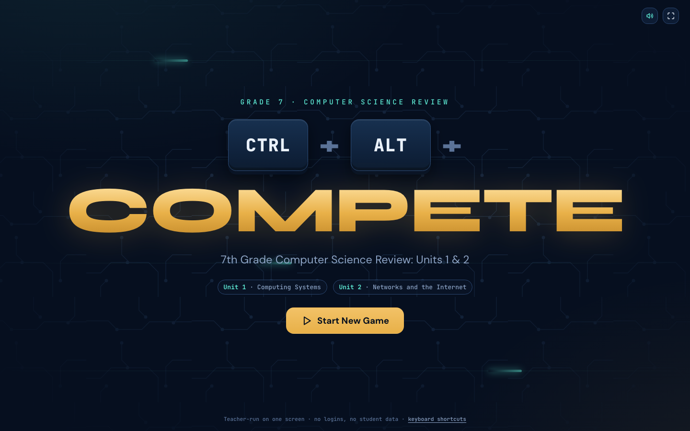

# CTRL + ALT + COMPETE

**Live: https://crystal-gazebo-e6bv.here.now/**

A Jeopardy-style team review game I built for my 7th grade computer science classes, run from one SmartBoard.

**What I built**
- A full game engine in vanilla JS with no build step: board, timers, steals, wagers, a final round, undo, and read-aloud
- Every question lives in one JSON file, so teachers can swap in their own set from the Setup screen without touching code
- Keyboard-first controls so the teacher can run the whole game from a clicker or keyboard
- No logins and no student data. It works offline from `site/index.html`

**Stack:** HTML, CSS, vanilla JavaScript, static hosting on here.now

Teacher-hosted team review game for 7th grade CS (Unit 1: Computing Systems, Unit 2: Networks and the Internet).
Static site, no backend, no accounts. Runs on a SmartBoard/projector from one device.

## Run it
- Live: https://crystal-gazebo-e6bv.here.now/
- Offline: open `site/index.html` directly. It falls back to the bundled `site/questions.js` copy.

## Edit questions
1. Edit `site/questions.json` (schema: `samples/questions.sample.json`).
2. Run `./deploy.sh` — it rebuilds `questions.js` and republishes to the same URL.

Or, without redeploying: Setup screen → **Import questions.json**. The imported set is remembered in that browser
until you click **Use built-in set**.

## Teacher shortcuts
Space timer · C correct · X incorrect/intercept · 1–6 award steal / mark teams · R reveal · F follow-up ·
S read aloud · hold A peek answer · Esc back to board · Ctrl+Z undo · P pause · M mute · ? help

## Files
- `site/index.html`, `site/styles.css`, `site/app.js` — the game (vanilla JS, no build step)
- `site/questions.json` — all content; `site/questions.js` — generated offline copy
- `build.sh` — regenerate `questions.js`; `deploy.sh` — build + publish to here.now

## Why the full question bank isn't here
This game is used with real students, so the full question bank stays out of the public repo,
which keeps the answer key off GitHub. `samples/questions.sample.json` shows the schema with two questions; copy it to `site/questions.json` and run `./build.sh` to play locally. The code and build pipeline are all here.

## License
Code: MIT (see `LICENSE`). Built by [Brandon Webster](https://campgrnds.com).
